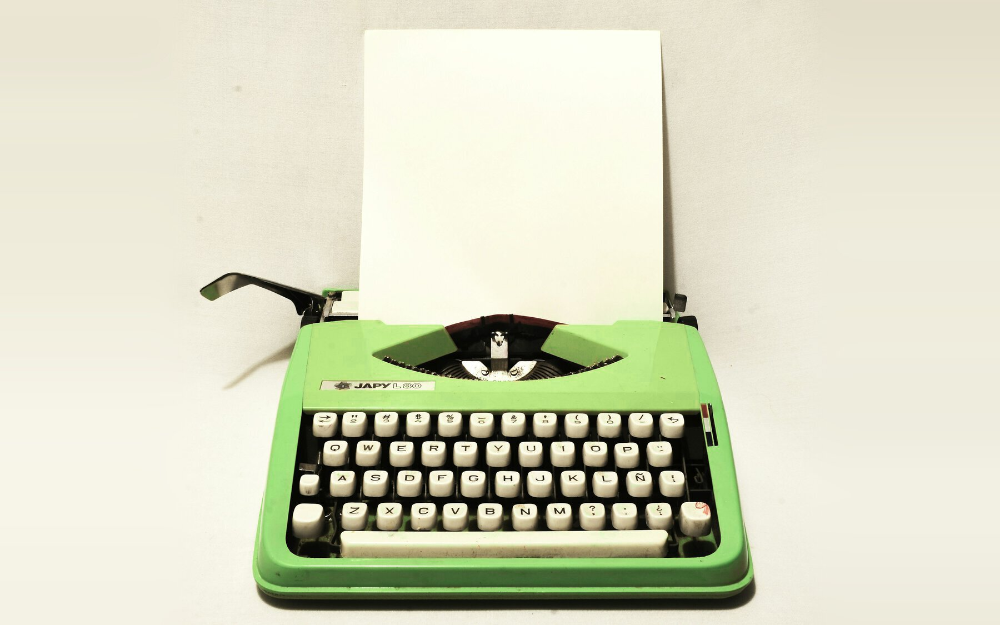

# Docsify for Open Education and Publishing

Markdown on the Web, with No Web Server Needed

Paul Hibbitts

<small>First Edition, 2026 · Updated Nov 9, 2026</small>

[CC BY 4.0](https://creativecommons.org/licenses/by/4.0/ ":class=navpill")

[Start Reading](docsify/why-it-matters.md ":class=button :class=primary")

Many educators want to share their Markdown as web pages, but a web server, a CMS or a build step gets in the way. This short guide introduces two free, open-source ways to skip the web server and the build step – Docsify-This and the Docsify Starter Kits – with your Markdown files kept somewhere public, such as a free GitHub repository, plus a path to a full Grav site when a project needs more.

> [!TIP]
> **Built on Docsify:** a free, open-source tool (over 30,000 stars on GitHub) that turns Markdown files into web pages right in the browser – no build step and no database, with your files hosted anywhere public, such as GitHub.

<small>Part 1</small>

<h2><a href="#/docsify/why-it-matters">Why It Matters</a></h2>

Your Markdown on the web, with no web server to set up or look after.

<small>Part 2</small>

<h2><a href="#/docsify/docsify-this">Docsify-This</a></h2>

Turn any public Markdown file into a styled web page, instantly.

<small>Part 3</small>

<h2><a href="#/docsify/starter-kits">Docsify Starter Kits</a></h2>

Your own open course or publishing site on GitHub Pages, with no build step.

<small>Part 4</small>

<h2><a href="#/docsify/moving-to-grav">Moving to Grav, and Back</a></h2>

When a full site is worth it – and how your Markdown gets there.

<small>Part 5</small>

<h2><a href="#/docsify/which-one-fits-you">Which One Fits You?</a></h2>

Pick a starting point – plus the trade-offs to know first.

This work by <a href="https://hibbittsdesign.org/">Paul Hibbitts</a> is licensed under <a href="https://creativecommons.org/licenses/by/4.0/">CC BY 4.0</a>. Cover photo by <a href="https://unsplash.com/@du_sable_et_du_vent">Baptiste Riethmann</a> on <a href="https://unsplash.com/photos/vintage-green-typewriter-with-blank-paper-jOQj5RQVmvg">Unsplash</a>.

<!-- Hides the sidebar on this page -->

