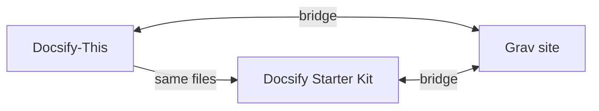

[← Docsify for Open Education and Publishing](docsify/README.md)

# Moving to Grav, and Back

<small>Part 4 of 5</small>

**When a full site helps:** editing in the browser with an admin panel, a search box across all your guides, Keep My Place for returning readers, or a blog alongside – that's when a free [Grav](https://getgrav.org/) website starter fits better. It needs a PHP web host, but still no database.

- **[Open Publishing Course Space Bridge](https://open-publishing-course-space-bridge.hibbittsdesign.org/)** – moves guides or courses between Docsify and Grav Open Publishing Space or Open Course Space, in either direction, with the same Markdown
- **[Docsify Common Cartridge Converter](https://docsify-common-cartridge-converter.hibbittsdesign.org/)** – turns a Canvas, Moodle or Brightspace course export into Markdown pages for Docsify
- **[Pressbooks Converter](https://pressbooks-converter.hibbittsdesign.org/)** – its Standard Markdown option suits a Docsify site too

**A way back:** moving to Grav doesn't lock you in – the bridge moves your guides or course back to Docsify whenever you want, for example if you lose access to a web host.

For the Grav side, see [Open Textbooks, Guides and Courses](guide/README.md) or [Grav 2 for Open Education and Publishing](grav-2/README.md).

Examples: [courses on Docsify-This](https://docsify-this.net/?basePath=https://raw.githubusercontent.com/paulhibbitts/docsify-this-open-course-space-site/main&homepage=home.md&sidebar=true&loadSidebar=_sidebar.md&loadNavbar=_navbar.md&pagination=true&searchbox=true&name=Open%20Course%20Space), converted from the Open Course Space demo · [a Docsify Open Courses Starter Kit](https://demo.hibbittsdesign.org/variants/docsify-open-courses-starter-kit/), converted to Grav
