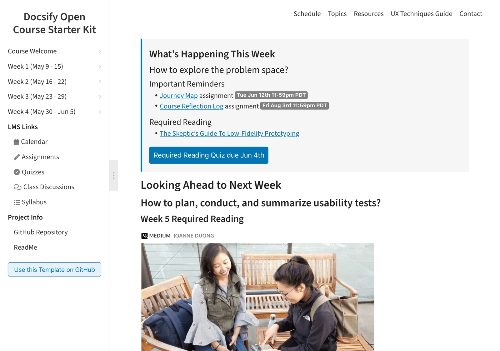
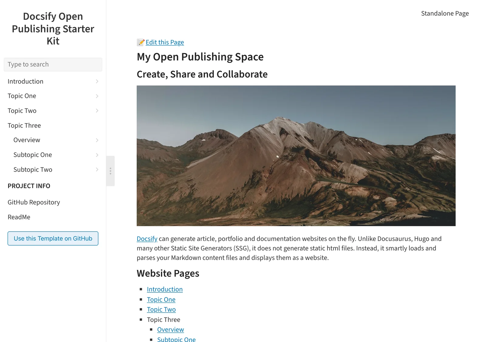

[← Docsify for Open Education and Publishing](docsify/README.md)

# Docsify Starter Kits

<small>Part 3 of 5</small>

Free, open-source templates that turn Docsify into a ready-to-run site – hosted free on GitHub Pages, or anywhere else, with your own domain if you like.

- **[Open Course Kit](https://hibbitts-design.github.io/demo-docsify-open-course-starter-kit/#/)** – a single open course site, with course navigation and a sidebar
- **[Open MultiCourse Kit](https://hibbitts-design.github.io/demo-docsify-open-multicourse-starter-kit/#/)** – several courses from one site
- **[Open Publishing Kit](https://hibbitts-design.github.io/demo-docsify-open-publishing-starter-kit/#/)** – articles, tutorials and documentation, with layouts for [a single guide](https://hibbitts-design.github.io/demo-docsify-open-publishing-starter-kit-guide/#/) and [multiple guides](https://hibbitts-design.github.io/demo-docsify-open-publishing-starter-kit-multiple-guides/#/)

*An open course site, from the Open Course Kit demo*

*An open publishing site, from the Open Publishing Kit demo*

**What you get:** your own address and full CSS control, an optional "Edit this Page" link for open authoring, LMS-ready embedding, and changes that go live shortly after you commit them – with no build step or pipeline to maintain.

**Moving from Docsify-This:** a site you started with Docsify-This moves to a Starter Kit as it is – copy your Markdown files into the kit's repository, and they become your own hosted site, with your own address and styling.

**Docsify-This or a Starter Kit?** Comfortable with GitHub, or want your own address and styling? Choose a kit. Not sure yet? Start with Docsify-This, and move to a kit whenever you're ready.
