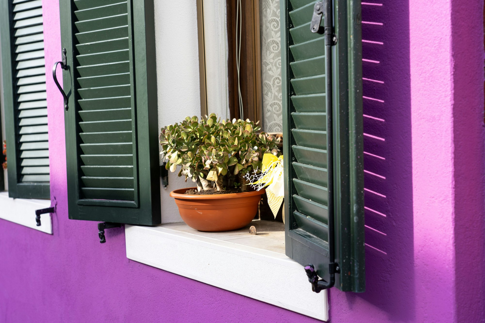

# Grav 2 for Open Education and Publishing

A DIY Platform You Own, in Plain Markdown

Paul Hibbitts

<small>First Edition, 2026 · Updated Nov 12, 2026</small>

[CC BY 4.0](https://creativecommons.org/licenses/by/4.0/ ":class=navpill")

[Start Reading](grav-2/why-it-matters.md ":class=button :class=primary")

Open textbooks, guides and courses are meant to be shared and reused, but the platforms they live on don't always make that easy for their authors. This short guide introduces [Grav 2](https://getgrav.org/), a free, open-source flat-file CMS (website system) that keeps every page in plain Markdown on a site you control – and shows why it suits open education and publishing, with free starters and converters built on it.

This version of the guide is published with [Docsify-This](https://docsify-this.net), straight from its Markdown files – [the original](https://read-move-reuse.hibbittsdesign.org/grav-2) is one of five guides on a Grav 2 site built with Open Publishing Space.

<small>Part 1</small>

<h2><a href="#/grav-2/why-it-matters">Why It Matters</a></h2>

Open content that is also open for its authors – to edit, move and keep.

<small>Part 2</small>

<h2><a href="#/grav-2/meet-grav-2">Meet Grav 2</a></h2>

A free, open-source flat-file CMS: Markdown files in, a website out – no database.

<small>Part 3</small>

<h2><a href="#/grav-2/why-it-suits-open-education">Why It Suits Open Education and Publishing</a></h2>

What Grav 2 offers readers and learners, authors, and whoever runs the site – and how it compares.

<small>Part 4</small>

<h2><a href="#/grav-2/open-publishing-space">Open Publishing Space 2</a></h2>

A free starter for open textbooks and guides – plus converters to bring in what you already have.

<small>Part 5</small>

<h2><a href="#/grav-2/open-course-hub">Open Course Space</a></h2>

Open Publishing Space's twin, for open courses – plus a converter to bring in an LMS course.

<small>Part 6</small>

<h2><a href="#/grav-2/getting-started">Getting Started</a></h2>

Pick the starter for your book or course, try it with nothing to install – plus the limits to know first.

> [!NOTE]
> **Reuse this guide** – it's licensed [CC BY 4.0](https://creativecommons.org/licenses/by/4.0/): copy it, adapt it and share it, with credit.

This work by <a href="https://hibbittsdesign.org/">Paul Hibbitts</a> is licensed under <a href="https://creativecommons.org/licenses/by/4.0/">CC BY 4.0</a>. Cover photo by <a href="https://unsplash.com/@ksakai">Katz Sakai</a> on <a href="https://unsplash.com/photos/potted-jade-plant-on-windowsill-T0ldSUxU-HE">Unsplash</a>.

<!-- Hides the sidebar on this page -->

