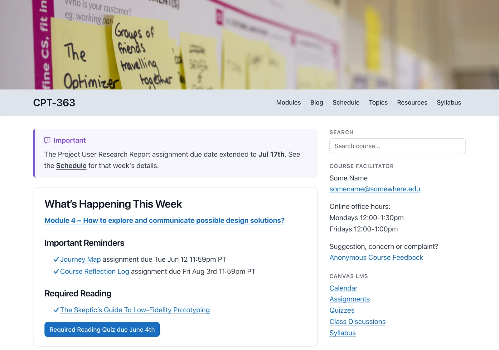

[← Grav 2 for Open Education and Publishing](grav-2/README.md)

# Open Course Hub 2

<small>Part 5 of 6</small>

Its twin, for **courses**: a free, open-source course site organized by modules.

- A module list beside every module page, with Previous and Next
- Home page reminders that link to this week's and next week's modules
- An optional course blog

Pages **embed in Canvas, Moodle or Brightspace** – just add `?embedded=true` (this works for Open Publishing Space pages too).

Teaching several courses? Its sibling, **Open MultiCourse Hub 2**, gives each one its own course site, all in a single install.

*A course home page, from the Open Course Hub demo*

Already have a course in your LMS? Start from it, with a free converter (in beta) – no Grav installation needed to see what carries over:

- **[Common Cartridge Converter](https://common-cartridge-converter.hibbittsdesign.org/)** – export a course from Canvas, Moodle, Brightspace or Blackboard, and download its modules, ready for Open Course Hub

Example (a raw conversion, with no revisions or fine-tuning): [LMS course content in Open Course Hub](https://demo.hibbittsdesign.org/grav-open-course-hub-common-cartridge-it2dda/)

See the demo: [Open Course Hub](https://demo.hibbittsdesign.org/grav-open-course-hub/) · [a module, embedded](https://demo.hibbittsdesign.org/grav-open-course-hub/modules/module-04?embedded=true) · [Open MultiCourse Hub](https://demo.hibbittsdesign.org/grav-open-multi-course-hub/)

Try the Admin 2 panel: [read-only demo](https://try.hibbittsdesign.org/grav-skeleton-course-hub/admin) (the sign-in details are on its sign-in screen).

For more, see the [Open Courses](open-course-hub/README.md) guide.
