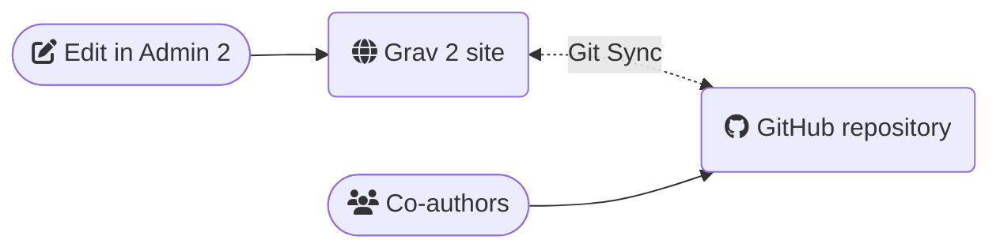
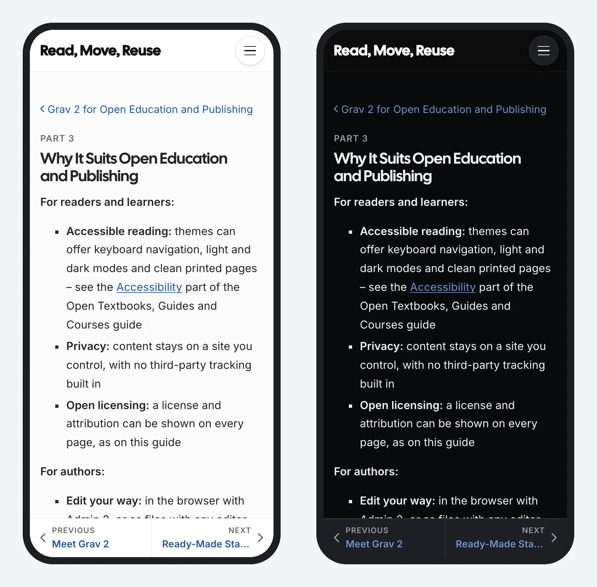

[← Grav 2 for Open Education and Publishing](grav-2/README.md)

# Why It Suits Open Education and Publishing

<small>Part 3 of 6</small>

**For readers and learners:**

- **Accessible reading:** themes can offer keyboard navigation, light and dark modes and clean printed pages – see the [Accessibility and Privacy](guide/accessibility.md) part of the Open Textbooks, Guides and Courses guide
- **Privacy:** content stays on a site you control, with no third-party tracking built in
- **Open licensing:** a license and attribution can be shown on every page, as on this guide

**For authors:**

- **Edit your way:** in the browser with Admin 2, or as files with any editor – and with Git, for a full history of every change and help from others
- **Content that lasts:** plain Markdown files stay readable in any text editor, long after a platform changes
- **Content that moves:** pages go between Grav sites, [Docsify-This](https://docsify-this.net/) (which shows Markdown as web pages), GitHub and other tools with little rework
- **Reuse built in:** anyone can get the Markdown behind a page, to adapt and share under its open license

Optional: with the free [Git Sync](https://github.com/trilbymedia/grav-plugin-git-sync) plugin, every change is saved to a GitHub repository with its full history, and co-authors can suggest edits there.

**See an example:** the original site's pages are in a [public GitHub repository](https://github.com/paulhibbitts/read-move-reuse/tree/main/quark2/pages), just as Git Sync would keep them – see [this page's own file](https://github.com/paulhibbitts/read-move-reuse/blob/main/quark2/pages/05.grav-2/03.why-it-suits-open-education/section.md), or [every edit to it](https://github.com/paulhibbitts/read-move-reuse/commits/main/quark2/pages/05.grav-2/03.why-it-suits-open-education/section.md).

**For whoever runs the site:**

- **Low cost and upkeep:** no build tools, and a standard PHP web host is enough
- **Compared with WordPress:** pages are Markdown files rather than database entries and blocks, so there are fewer moving parts to keep updated

**How it compares** with other popular tools for open textbooks, guides and courses – WordPress-based book tools such as Pressbooks, and static site tools such as Quarto, Jupyter Book and Jekyll:

| | Grav 2 | WordPress-based (such as Pressbooks) | Static site tools |
|---|---|---|---|
| Content stored as | Markdown files | A database | Markdown files |
| Editing | In the browser (Admin 2), or any editor | In the browser | Edit files, then run a build |
| Hosting | A PHP web host (PHP 8.3 or newer) | A hosted service, or your own WordPress | Free static hosting, such as GitHub Pages |
| Markdown of every page | Built in | Not built in | The source files themselves |
| EPUB and formatted PDF | No – pages print cleanly | Yes – a real strength | Yes, especially Quarto |
| Books and courses from the same content | Yes, with the free starters | Books | Possible, with setup |

Pick a WordPress-based book tool such as Pressbooks if you need EPUB or print-ready PDF, or a static site tool if you're comfortable with Git and want free hosting.

*This page on a phone, in light and dark mode*

Try it on [the original site](https://read-move-reuse.hibbittsdesign.org/grav-2/why-it-suits-open-education): press → for the next page, **/** to search, switch to dark mode (top right), or open print preview.

**See it moved:** this site's [Open Textbooks, Guides and Courses](guide/README.md) guide also runs, with the same content, on [the Quark 2 theme](https://read-move-reuse.hibbittsdesign.org/guide) and [the classic Quark theme](https://one.on-rev.com/grav/read-move-reuse-ops-quark/guide), as an [Open MultiCourse Hub course](https://one.on-rev.com/grav/read-move-reuse-mch/guide), and on Grav Premium Helios as an [open reader](https://one.on-rev.com/grav/read-move-reuse-hor/guide) and a [course hub](https://one.on-rev.com/grav/read-move-reuse-hch/guide).

> [!TIP]
> **A domain of one's own:** because a Grav 2 site is just a folder of files, it's a good fit for personal or institutional web hosting – your content isn't tied to a single platform or host.

> [!NOTE]
> Accessibility also depends on the content – see [Improving the Accessibility of Your Markdown](https://www.smashingmagazine.com/2021/09/improving-accessibility-of-markdown/).
