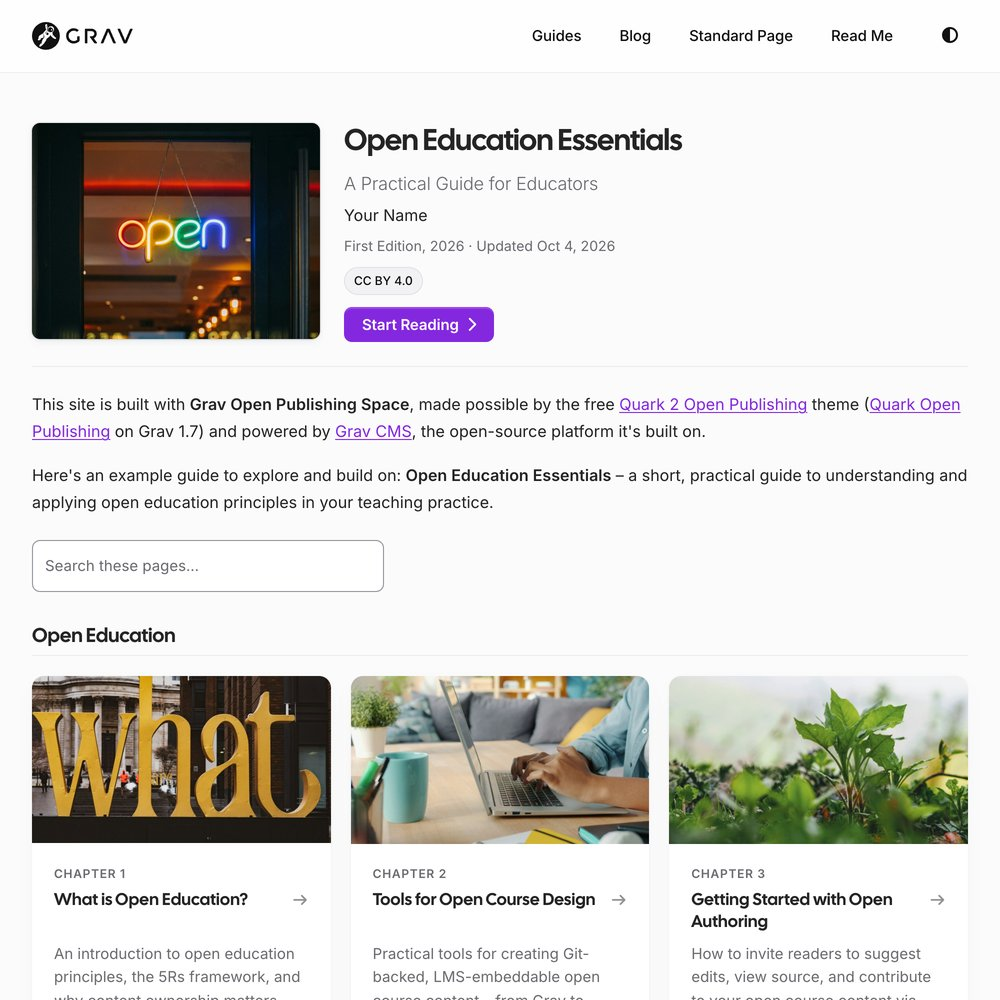
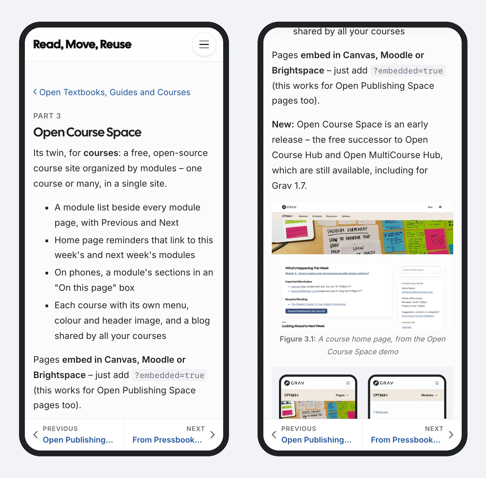

[← Open Textbooks, Guides and Courses](guide/README.md)

# Open Publishing Space

<small>Part 2 of 7</small>

A free, open-source website starter for **open textbooks and guides**, with a blog alongside.

- Guides with section cards, reading progress, Learning Objectives, OER attribution, search and **Keep My Place** (pick up where you left off, even partway down a page)
- Present a guide like slides with the ← and → keys
- A "This page as Markdown" link on every page – for you, and with an open licence anyone, to reuse
- One site can hold several guides, each with a card on a Guides page and its own pages in the menu (like this guide's Topics and Resources) – plus site pages like [About](about/README.md)
- Diagrams and math written as plain text, with the free [Mermaid](https://hibbittsdesign.org/cost-free-grav-projects.html#mermaid-plugin) and [LaTeX Math](https://hibbittsdesign.org/cost-free-grav-projects.html#latex-math-plugin) plugins – like $E = mc^2$, or this diagram:

*A guide home page, from the Open Publishing Space demo*

*A page of this guide on a phone: the header slides away as you read, and Previous/Next stay at the bottom*

See the demo: [one guide](https://demo.hibbittsdesign.org/grav-open-publishing-quark2/) · [several guides](https://demo.hibbittsdesign.org/variants/grav-open-publishing-quark2-guides/)

Try the Admin 2 panel: [read-only demo](https://try.hibbittsdesign.org/grav-skeleton-open-publishing-space/admin) (the sign-in details are on its sign-in screen).

> [!NOTE]
> **See the demo** – [Open Publishing Space with a sample guide](https://demo.hibbittsdesign.org/grav-open-publishing-quark2/) – and the original version of this guide is built with it.
