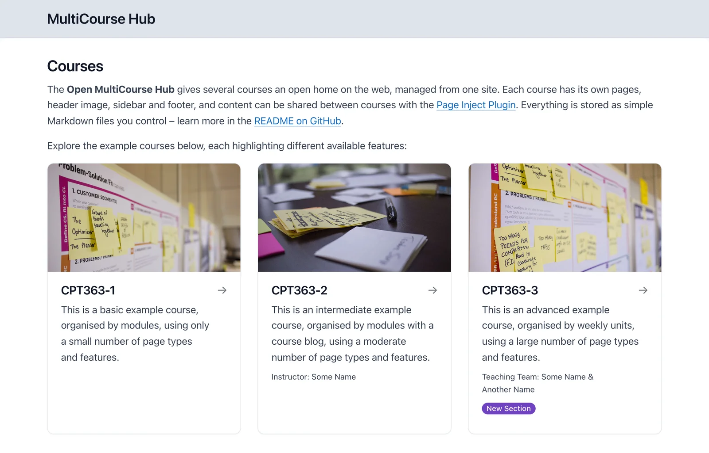

[← Open Courses](open-course-hub/README.md)

# Open MultiCourse Hub 2

<small>Part 3 of 6</small>

Teaching several courses? **Open MultiCourse Hub 2** gives each one its own course site – with its own modules, home page and optional blog – all in a single install.

- The same module pages, reminders and embedding as Open Course Hub
- One site to host, update and back up, however many courses you teach
- Each course keeps its own address, ready to link from or embed in your LMS

*The Courses page, from the Open MultiCourse Hub demo*

[See the demo](https://demo.hibbittsdesign.org/grav-open-multi-course-hub/)

> [!NOTE]
> Want to jump right in? Download [Open MultiCourse Hub](https://getgrav.org/downloads/skeletons#multicourse-hub-site) or try the [demo](https://demo.hibbittsdesign.org/grav-open-multi-course-hub/).
